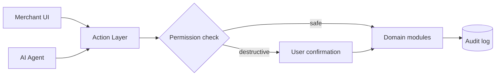
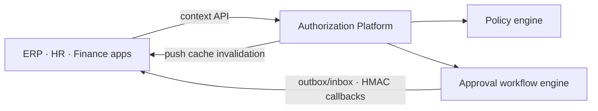
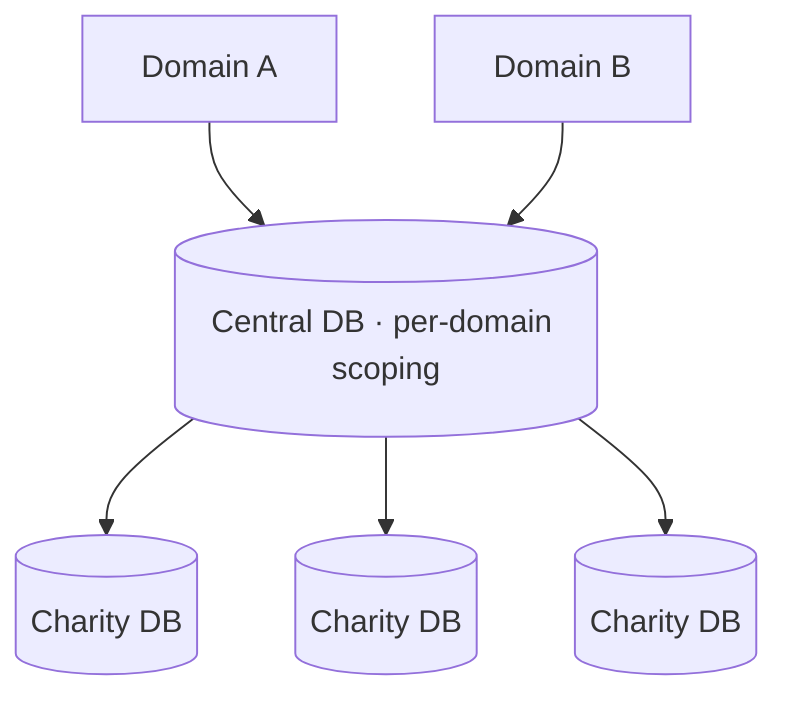

<h1 align="center">Asmaa Rasmy</h1>

<b>Lead Full Stack Engineer</b> · Laravel · React · AI Agents · Multi-tenant SaaS

  
  

---

I design and lead the delivery of multi-tenant SaaS platforms, from architecture and data modelling to code review and production releases. I currently lead a 7-person engineering team, and my focus is on system design: tenant isolation, authorization and workflow engines, reliable async processing, and AI agents that run safely in production.

> Most of my work lives in private employer and client repositories. The notes below describe the systems and the design decisions behind them, without any proprietary code.

## Featured Systems

### 1. AI-native commerce platform
An AI agent that works as a first-class user: it can create, find and update anything a merchant can, in Arabic or English, live for every merchant.

**Key decisions:** one action layer shared by the UI and the agent, so both pass the same permission checks; human confirmation before destructive actions; a full audit trail of agent activity; queue-based pipelines for AI image, video and product data generation.

### 2. Central authorization & approvals platform
A single source of truth for permissions and approvals across ERP, HR and finance systems.

**Key decisions:** a policy engine with attribute-based record scopes, field-level rights and deny-overrides; client-side caching with push-based invalidation; fail-closed behavior when the service is unreachable; HMAC-signed callbacks and outbox/inbox delivery for reliable approvals; versioned policies with a simulator for safe changes.

### 3. Two-level multi-tenant donation platform
A white-label platform serving charities across multiple countries.

**Key decisions:** branded domains sharing one central database with per-domain data scoping, each hosting charities on isolated tenant databases; per-charity ledgers for fees, withdrawals and refunds; versioned donor consent and sanctions enforcement; per-tenant payment and SMS providers with automatic failover.

## Tech Stack

**System design:** multi-tenancy · authorization policy engines · approval workflows · event-driven & queues · outbox/inbox · idempotency · ledgers & payment orchestration

---

<i>Open to Senior and Lead full-time remote roles · Cairo, Egypt (UTC+2/+3)</i>

